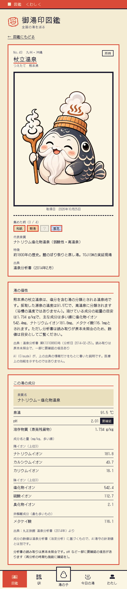
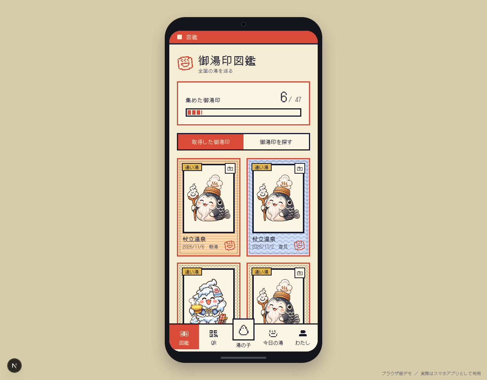
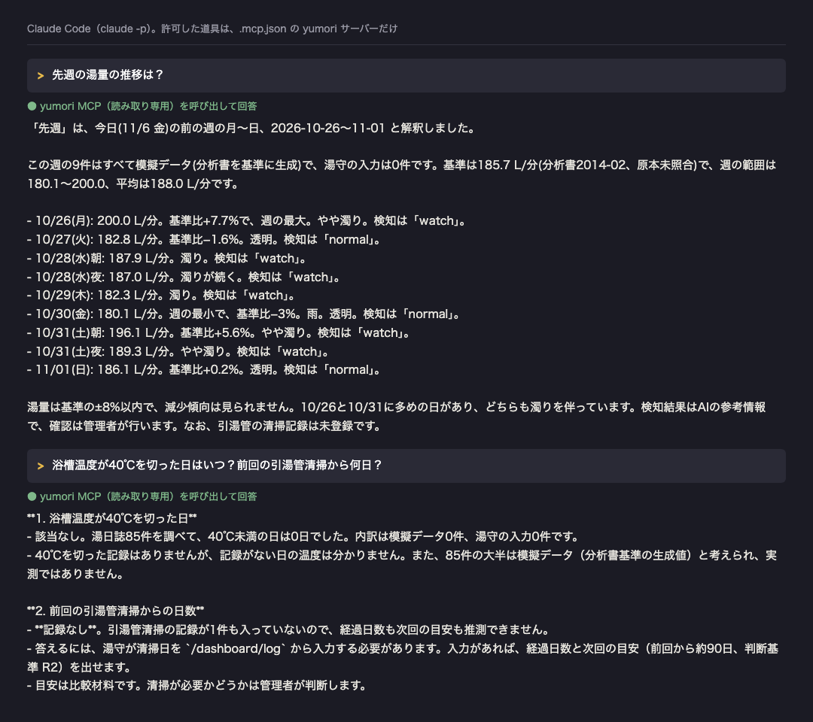

# AI湯守 × 御湯印（Built with Claude: Japan 2026）

**熊本・杖立温泉の丸正旅館（約100年、2026年に事業承継）で、湯守の「湯を見る目」を、湯日誌と AI の変化検知・引き継ぎメモで次の人が受け継げる形にし、同じデータで温泉地を巡って集める「御湯印図鑑」に、湯の“今日”を届ける。**

- **AI湯守（施設向け）**：毎日の湯日誌（温度・湯量・濁り・におい）を Claude が点検し、「要確認」の理由と次に見ることを返す。引き継ぎメモも下書きする。湯守の判断は置き換えない
- **御湯印図鑑（一般向け）**：温泉地でQRを読んで御湯印を集めるアプリ。AI湯守を導入した施設（丸正旅館）の御湯印だけ、「今日の湯」が動く

> 丸正旅館の日次計測値は、温泉分析書（2014年2月）を基準に生成した**模擬データ**です。実測値ではありません（[安全・データ方針](#8-安全データ方針)）。

## 1. 画面

| 御湯印の詳細（`/goyuin/43`） | 御湯印図鑑（`/goyuin`） |
| --- | --- |
|  |  |

左：杖立の御湯印。「湯の個性」は Agent SDK が書いた説明（出典つき・AI 生成と明記）、「この湯の成分」は分析書の値（pH は要確認の印つき）。右：集めた御湯印。デモ用の状態（`npm run demo-seed`）。

**Claude Code から湯日誌に質問する**（MCP。回答の文面は `claude -p` の実際の出力で、見た目だけ端末風に整えた。許可した道具は yumori サーバーだけ）：



引湯管清掃の記録は DB に1件もないため、「記録なし」と答え、日数は推測していない。

## 2. Claude の使い分け

| 仕組み | なぜ選んだか | 実ファイル |
| --- | --- | --- |
| **CLAUDE.md** | 毎回の作業で、禁止事項（模擬データの明示・医療表現・出典・秘密情報）を忘れさせないため。作業の進め方と DB の退避手順も常駐させる | [CLAUDE.md](CLAUDE.md) |
| **Messages API + tool use（Haiku 5.5）** | 湯日誌1件ごとに自動で走るので、安く速いモデル。基準値・直近14日・天候を Claude 自身がツールで取りに行き、判断の理由を構造化して返す。「浴槽41℃未満は要確認」「38℃未満は最優先」はモデル任せにせず、コードの規則でも担保（直らなければ補正） | [src/lib/detection.ts](src/lib/detection.ts)、[src/lib/models.ts](src/lib/models.ts)、[eval/scenarios.json](eval/scenarios.json) |
| **Messages API（Sonnet 5.5）** | 引き継ぎメモは頻度が低く、文章の質を優先するため。材料（湯日誌・検知・メンテ記録・湯守の判断基準）を欄分けして渡し、数値の取り違えを防ぐ | [src/lib/handover.ts](src/lib/handover.ts) |
| **Skill `onsen-sheet`** | 「分析書の画像→構造化 JSON→整合性の検査」は手順が決まった繰り返し作業。数値の検査（mval% の合計・pH と分類の整合・成分表と下段の不一致・分析から10年）は計算なので、LLM ではなくスクリプトにした。見つけた食い違いは「要確認」を付けるだけで、数値は直さない | [SKILL.md](.claude/skills/onsen-sheet/SKILL.md)、[check.mjs](.claude/skills/onsen-sheet/check.mjs) |
| **サブエージェント** `safety-reviewer`・`data-consistency-reviewer` | 実装した本人の文脈を持たない読み取り専用の目で、医療・安全保証の表現と、出典なしの数値・模擬ラベルの欠落・CSV と DB の不一致を探すため。ファイルは直さず、指摘と修正案だけ返す | [safety-reviewer.md](.claude/agents/safety-reviewer.md)、[data-consistency-reviewer.md](.claude/agents/data-consistency-reviewer.md) |
| **フック（git pre-commit）** | 注意力に頼らず、機械的に止めるため。`.env` の混入・`sk-ant-` の実キー・「模擬」表示のない画面があればコミットを止める。Claude Code のフックにしなかったのは、`git add … && git commit` と続けて実行されると、検査の時点でステージが空になるため | [pre-commit-check.mjs](.claude/hooks/pre-commit-check.mjs)、[pre-commit](.claude/hooks/pre-commit) |
| **MCP サーバー `yumori`** | 画面を開かずに、Claude Code から「先週の湯量の推移は？」と聞けるようにするため。DB は読み取り専用で開き、返す値すべてに「模擬データ／湯守の入力」の区別を付ける。記録がなければ「記録なし」と返し、推測しない | [mcp/yumori-server/](mcp/yumori-server/)、[.mcp.json](.mcp.json) |
| **Agent SDK** `@anthropic-ai/claude-agent-sdk` | 「書く→点検する→差し戻す→出典を付ける」という役割分担を、画面の外の生成バッチとして動かし、DB にキャッシュするため（画面を開いても API は呼ばない）。writer（Sonnet）／safety-checker（コードの検査＋Haiku）／citer（出典の番号と日付を LLM に書かせないよう、コード）の3段 | [src/agents/](src/agents/)、[scripts/gen-personality.ts](scripts/gen-personality.ts) |

エージェントは、判断を置き換えるものではなく見落としを減らすためのものです。指摘が正しいかは人が確認します。

## 3. Claude Code で可能になったこと

- **4日間（11/3〜11/6）で 51 コミット**（49 に Claude の共著の記録）。`src/`・`scripts/`・`mcp/`・`.claude/` で約 9,900 行、テスト 191 件（27 ファイル）
- **変化検知の評価（20シナリオ）を 17/20 → 20/20 に**（11/3 16:41 → 11/4 10:55）。途中で見つけた「検知の出力に JSON の断片が約3割混ざる」問題は、検査と再試行で直した
- **点検役が、人の見落としを見つけた**：保存済みの宿泊客向け説明の 9 行に「安心して〜」が残っていた（禁止語の一覧に「安心」が入っていなかった）。直して一覧に足した。47件の「湯の個性」の生成では、7件が点検で差し戻された（杖立は「1kgあたり」の「1」が、渡していない数値として止まった）

## 4. 試行錯誤の記録

- **決定事項（何を決め、何を捨てたか）**：[docs/decisions.md](docs/decisions.md)。**日次ログ（詰まったことを含む）**：[docs/devlog.md](docs/devlog.md)。**湯守の判断（仕様の根拠）**：devlog の末尾「湯守の判断」
- **変化検知の評価（eval）の推移**（Haiku 5.5。結果は [eval/results/](eval/results/) に全件残している）

  | 実行 | 合格 | 備考 |
  | --- | --- | --- |
  | 11/3 16:18 | 5/5 | 初期10件のうち5件だけ |
  | 11/3 16:41 | 17/20（85%） | 全20件。S07・S15・S16 が不合格（期待値どうしの衝突を含む） |
  | 11/3 16:58 | 19/20（95%） | 湯守の浴槽41℃・濁りのルールを反映。S07 のみ不合格 |
  | 11/4 09:49 | 20/20（100%） | |
  | 11/4 10:01 / 10:46 | 19/20 | 実行ごとの揺れ（モデルの出力は毎回少し変わる） |
  | 11/4 10:55 | 20/20（100%） | 最新 |

  合格率が上がったのは、プロンプトとコードの規則の調整に加えて、**一部の期待値を見直した**ため（S07・S04・S15・S16。湯守のルール変更の帰結として行い、理由を decisions.md に残している）。評価セットには、現場由来（`field`）と想定（`hypothetical`）の区別がある。
- **11/6 の DB 事故と再発防止**：撤回作業のために DB を `cp` で戻したところ、コピーに **WAL（未反映の変更）が入っておらず**、御湯印の記録（6件→1件）・湯の子・写真の枚数・2温泉地の画像の紐づけを失った。日誌・検知結果・分析書は無事。マイグレーションの再適用・seed・demo-seed で画面は復旧した（demo-seed は最初、ブラウザとは別の key に入れてしまい、サーバーのログで気づいて直した）。**再発防止として、DB を触る作業の前は必ず `sqlite3 … ".backup"` で退避する手順を [CLAUDE.md](CLAUDE.md) に追記**した

## 5. 実装済み／模擬データ／未実装

| 区分 | 内容 |
| --- | --- |
| **実装済み** | 湯日誌の入力と変化検知（Haiku）、推移グラフ、引き継ぎメモ（Sonnet）、ダッシュボードのトップ（今日の湯の要約と「記録する／見る／基本情報」）、ご来訪と売上（`/dashboard/visits`。月→週→日のドリルダウン、御湯印の売上＝来客×300円、都道府県のタイル地図）、D1 基準値（分析書）画面、お客様の声（`/dashboard/voices`。浴槽温度と評価平均のグラフ、SQL の集計とひとことを Sonnet が突き合わせるコメント。入力と出力を保存）。御湯印図鑑：地図、QR着地での取得、図鑑、レベル・称号・実績、今日の湯、未所持の秘密化（サーバーが返さない）、湯の子の育成、御湯印カードの裏面の絵、思い出の写真（2枚まで・EXIF除去）、成分表示、湯の個性（47件）。Claude Code まわり：Skill・サブエージェント2つ・pre-commit フック・MCP・Agent SDK |
| **模擬データ・サンプル** | **丸正旅館の湯日誌**（84件。分析書を基準に ±10% で生成。実測値ではない）と、それに対する検知結果（Claude の出力）。**QR読み取りは擬似**（カメラを使わず、選んだ温泉地の着地ページへ移るだけ）。キャラ画像があるのは6か所（残りは泉質の分類から作った仮の絵）。称号・実績の名前は仮。デモ用の初期状態（`demo-seed`）とデモ用写真（代表者本人の写真）。**湯の声と来客はすべてサンプル**（評価とひとこと・都道府県の 201 件は実際の利用者の記録ではなく、決まった文や重みから作ったもの。御湯印の売上も実際の売上ではなく来客数×300円の計算）。**男湯・女湯の浴槽温度は将来の運用案**（浴槽ごとには測っておらず、湯日誌の浴槽温度を基準に生成） |
| **未実装** | 御湯印から湯の声（評価とひとこと）を集める入力画面、浴槽別の温度の記録（湯日誌への統合）、入浴記録（G4）、天候の取得（いまはスタブ）、実センサー連携、丸正旅館以外の施設の「今日の湯」、記録の引き継ぎ（いまの匿名キーは端末のブラウザにだけ保存）、公開サーバーへの配置（いまは SQLite の `localhost` のみ）。湯守の判断基準 R5・R6（浴槽清掃のあとの温度低下・引湯管清掃のあとの温度上昇）は記録済みだが、検知にはまだ使っていない。「湯の個性」の確認状況（11/6）：杖立は湯守（小野）が確認済み。他46件は代表泉質だけから書いた一般的な説明で、有名5件（別府・草津・有馬・道後・箱根）のみ確認し、残り41件は未読 |

画面・機能の詳細は [docs/goyuin-spec.md](docs/goyuin-spec.md)、要件は [docs/PRD.md](docs/PRD.md)、データ構造は [docs/DATA_MODEL.md](docs/DATA_MODEL.md)。

## 6. セットアップ

```
cp .env.example .env   # ANTHROPIC_API_KEY を記入（.env は git に入れない）
npm install            # 初回。pre-commit フックも有効になる（prepare）
npm run sim            # 模擬計測データを生成（data/maruso_daily_sim.json）
npm run seed           # DB 初期化と投入（47温泉地・丸正旅館・分析書・模擬日誌。模擬データだけを入れ替え、湯守が入力した記録や御湯印のデータは消さない。キャラ画像の有無もここで決まる）
npm run dev            # http://localhost:3000/dashboard/log と /goyuin
```

そのほかのコマンド：

```
npm run test                          # 191 件（Claude API は呼ばない）
npm run eval -- --only S01,S02        # 変化検知の評価（API を使う。引数なしで全20件）
npm run backfill                      # 模擬日誌への変化検知（API を使う）。結果は data/maruso_detections_sim.json に保存され、seed が読み込む
npm run personality -- --all          # 47件の「湯の個性」を生成（API を使う。生成済みは飛ばす。--code 43 で杖立だけ）
npm run demo-seed -- <user_key>       # 撮影用：御湯印6温泉地と湯の子を作る。取得記録と写真を消すので、先に DB を退避（下）。user_key はブラウザの localStorage yumori_user_key
npm run check:commit                  # コミット前チェックを全体に実行
npm run check:sheet                   # 分析書 JSON の整合性検査
```

- **DB を触る前の退避**：`sqlite3 data/yumori.db ".backup 'data/backup-<作業名>.db'"`（`cp` は不可。理由は上の事故）
- **`npm run build` の前に dev を止める**：同じ `.next` を書き換えるため、止めずに動かすと CSS が 404 になり画面の装飾が消える
- **MCP**：リポジトリで `claude` を起動すると、`.mcp.json` の yumori サーバーに初回の承認で接続できる（`/mcp` で確認）。ツール：`get_latest_log`・`query_logs`・`find_days`・`get_baseline`・`get_maintenance`・`get_yumori_rules`。起動し直さずに試すとき：`claude -p "先週の湯量の推移は？" --mcp-config .mcp.json --allowedTools "mcp__yumori__*"`
- **湯の個性（Agent SDK）**：入力は、杖立は `data/maruso_analysis_2014.json`、他46件は `data/onsen_master_47.csv` の代表泉質だけ。点検を通らなかった温泉地は保存せず失敗として表示。各回の下書きと指摘は `onsen_personality.log` に残る

## 7. 湯守の判断基準と評価セットの出典

- [data/yumori_rules.json](data/yumori_rules.json)：この施設の湯守が定めた判断基準（R1〜R6）。`origin: field` は湯守の実体験・判断基準、`hypothetical` はそこから派生させた想定。AI湯守の点検では field を優先して引用し、画面・README・動画でも両者を混同しない
- [eval/scenarios.json](eval/scenarios.json)：変化検知の評価セット（20件）。S11〜S15 は現場由来（field）、S16〜S20 は想定（hypothetical）、S01〜S10 は初期の想定

## 8. 安全・データ方針

- **模擬データの明示**：丸正旅館の日次計測値は模擬データで、README・画面・動画で明記する。画面では、模擬の数値の横に小さく「模擬」を出す。実測データ（`is_simulated` が false）には出さない。MCP の返す値すべてにも、模擬データ／湯守の入力の区別が付く。pre-commit フックが、「模擬」表示のない画面を止める
- **医療・安全保証の表現は書かない**：「効く・治る・安全・保証・必ず」などを、画面・説明文・AI の出力に出さない。検知は「要確認」「管理者の確認を」の言い回しで、湯守の判断を置き換えない。守りは多重：プロンプトの禁止語 → 出力後の検査（禁止語があれば差し戻し）→ `safety-reviewer` の点検。「湯の個性」の説明は AI が書いたものだと明記し、医療上の効能を示すものではないと添える
- **出典**：47温泉地の泉質は「代表泉質（分類）」だけを表示し、数値は出典のあるものだけ（出典なしは「要確認」）。杖立の成分は分析書（第K13108663号、分析日 2014-02-25）によるもので、**読み取りは Claude が行い原本未照合**。pH は分類と食い違うため「要確認」の印を付けている。成分の数値は、AI湯守の計測値とは別
- **秘密情報・個人情報**：API キーは `.env` のみ（git 管理外。フックが混入を止める）。宿泊客・従業員の氏名、売上、契約はデータに入れない。御湯印の所持は匿名キー（端末のブラウザ）で判定し、ログインはない。思い出の写真は、サーバーで位置情報（EXIF）を除いて保存し、公開・共有しない
- **知財・期間**：キャラクターは自作の画像だけ。御湯印の絵は、`public/goyuin/` が「TOJISM 制作」、自動生成が「アプリ生成」。成果としているコードは、ハッカソン期間（2026-11-02 以降）に書いたものだけ（最初のコミットは 11/3）
